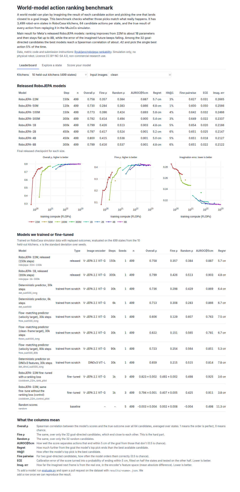
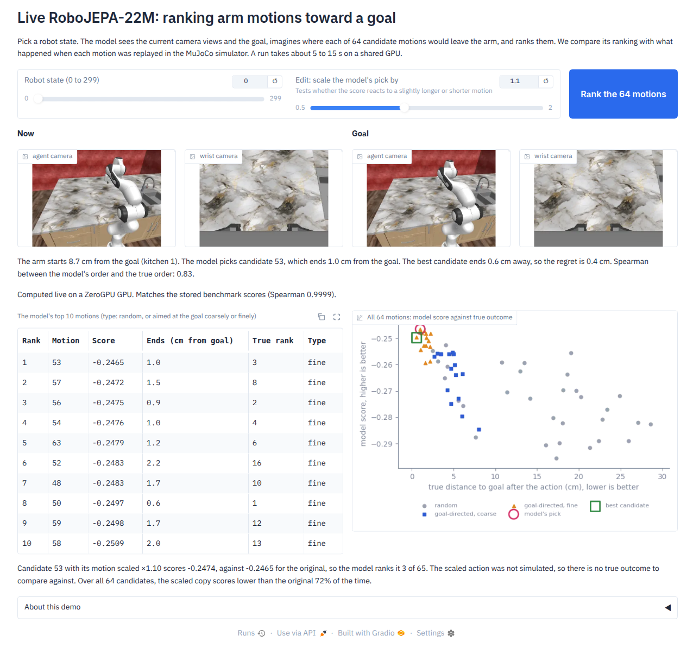

# World-model action rankability

Code, results and write-up for a study of one question: when a world model plans by imagining the result of each
candidate action and picking the one closest to a goal, does it pick the action that actually works? We test Meta's
released RoboJEPA models (22M to 8B parameters) on simulated robot-arm states in RoboCasa and on real robot video
from DROID. No physical robot was used.

Public artifacts:

- Benchmark data and evaluator: [Ryukijano/robojepa-rankability](https://huggingface.co/datasets/Ryukijano/robojepa-rankability)
- Leaderboard and state explorer: [Ryukijano/world-model-rankability](https://huggingface.co/spaces/Ryukijano/world-model-rankability)
- Live demo (private for now): [Ryukijano/world-model-rankability-live](https://huggingface.co/spaces/Ryukijano/world-model-rankability-live),
  RoboJEPA-22M running on ZeroGPU

## The benchmark

Each of 3,499 states (3,000 from 30 RoboCasa pretraining kitchens, 499 from 10 held-out kitchens) comes with 64
fixed candidate actions: 32 random and 32 aimed at the goal. We replay every candidate from a saved MuJoCo state to
get its true end position (replays agree to within 0.2 mm). A model scores each candidate; we measure how well its
order matches the true order. Protocol details are in [docs/PROBE_DESIGN.md](docs/PROBE_DESIGN.md) and all numbers in
[docs/RESULTS.md](docs/RESULTS.md).

Results on the 3,000 pretraining-kitchen states:

| Model size | Overall Spearman | Fine Spearman (goal-directed only) | Regret | Imagination error |
|---|---:|---:|---:|---:|
| 22M | .747 | .359 | 5.7 cm | .273 |
| 300M | .784 | .411 | 5.1 cm | .240 |
| 1B | .789 | .418 | 5.0 cm | .223 |
| 8B | .789 | .409 | 5.0 cm | .218 |

Ranking stops improving at about 300M to 1B parameters, while the error of the imagined future keeps falling up to
8B. Better imagination does not buy better choices past that point.

## What breaks

All from [breakage/FINDINGS_2026-10-28.md](breakage/FINDINGS_2026-10-28.md) and the scripts next to it.

1. **A resolution floor.** When two candidates' true outcomes differ by less than 5 mm, every model size orders them
   correctly 51 to 53% of the time, close to a coin flip. At 1 to 2 cm it is 59 to 61%; above 8 cm, 88 to 93%
   ([figure](breakage/resolution_floor.png)).
2. **Failures are shared across sizes.** 78% of the states where the 1B model's pick is more than 5 cm worse than the
   best option are also failures for 22M, and 19% fail for all eight sizes.
3. **Height is the weakest direction.** The 1B model's pick ends 3.0, 2.9 and 3.5 cm from the target in x, y and
   height; the best available candidate was 0.6 to 0.7 cm off on each axis.
4. **Scoring only the moving parts of the image makes it worse.** Restricting the score to the 50, 25 or 10% of image
   patches that change most lowered fine ranking for 1B from .418 to .361, .306 and .260. The floor sits in what the
   predictor represents, not in background pixels diluting the score ([breakage/score_cw.py](breakage/score_cw.py)).
5. **On real DROID video, coarse action identity is solved and magnitude is not.** Every model picks the true action
   sequence out of 16 almost every time (top-1 .996 to 1.0). Telling the true action from one with 10% more or less arm
   motion is near chance for 22M models (.48 to .65) and improves with scale (Meta 1B: .79 for ×0.9, .93 for ×1.1)
   ([breakage/eval_droid_action_id.py](breakage/eval_droid_action_id.py)).
6. **A ranking loss helps choices and hurts imagination.** Fine-tuning RoboJEPA-22M with a ranking loss on replayed
   outcomes raised held-out overall Spearman to .823 and fine Spearman to .492 (control fine-tune: .794 / .407), above
   the frozen 8B, while imagination error rose from .242 to .268.

## Live demo

[demo/live/space](demo/live/space) is a Gradio app on ZeroGPU. One `@spaces.GPU(duration=30)` call encodes the
current and goal views with V-JEPA 2.1 ViT-G, steps RoboJEPA-22M over the 64 candidates plus a scaled copy of each,
and returns the scores. Weights are Meta's, repackaged by [demo/live/export_weights.py](demo/live/export_weights.py)
(bf16 encoder, predictor only). On 30 states the live scores match the benchmark's stored scores with median
Spearman .99995 ([demo/live/verify_gpu.py](demo/live/verify_gpu.py)); the top pick differs on 6 of 30 because the top
two scores are often closer than 1e-4. [demo/static](demo/static) is the leaderboard Space.

## Next

[breakage/MODEL_PLAN.md](breakage/MODEL_PLAN.md) proposes a small world-action model trained from pixels on open real
video (DROID, AgiBot, Open-AoE), with hard counterfactual actions (the true action scaled by 0.9 or 1.1) as negatives,
aimed at the magnitude floor. The bar to beat is Meta 1B: .79 / .93 on the real-video ±10% test and .418 fine
Spearman in simulation.

## Repository layout

| Path | Contents |
|---|---|
| `probe/` | Anchor collection, scoring, metrics, feature caching, trained predictors and the ranking fine-tune |
| `breakage/` | Failure analysis, change-weighted scoring, DROID action-edit test, findings and model plan |
| `slurm/` | Isambard-AI job scripts (one GH200 per job) |
| `configs/` | Training configs for the predictors and fine-tunes |
| `hf/` | Builders for the HF dataset and Spaces, plus `evaluate.py` and `rankability_metrics.py` |
| `demo/` | Live ZeroGPU Space and static leaderboard Space |
| `skills/` | `deslop-writing` and `deslop-design`, the agent skills used to edit the public pages |
| `docs/` | Benchmark protocol and full results |

Paths in the scripts point at our Isambard project (`/projects/u6xn/rankability`); change `R` to run elsewhere.

## Licence and credit

RoboJEPA and V-JEPA weights and the vendored code under `demo/live/space/vendor/` are Meta's
([robo_jepa](https://github.com/facebookresearch/robo_jepa), CC BY-NC-SA 4.0;
[vjepa2](https://github.com/facebookresearch/vjepa2)); their licence files are kept there. Scores derived from
RoboJEPA are CC BY-NC-SA 4.0, so this repository is for non-commercial research use. RoboCasa is MIT. Prior work on
fixed-candidate action ranking: ARC-Bench and AD-WM.
