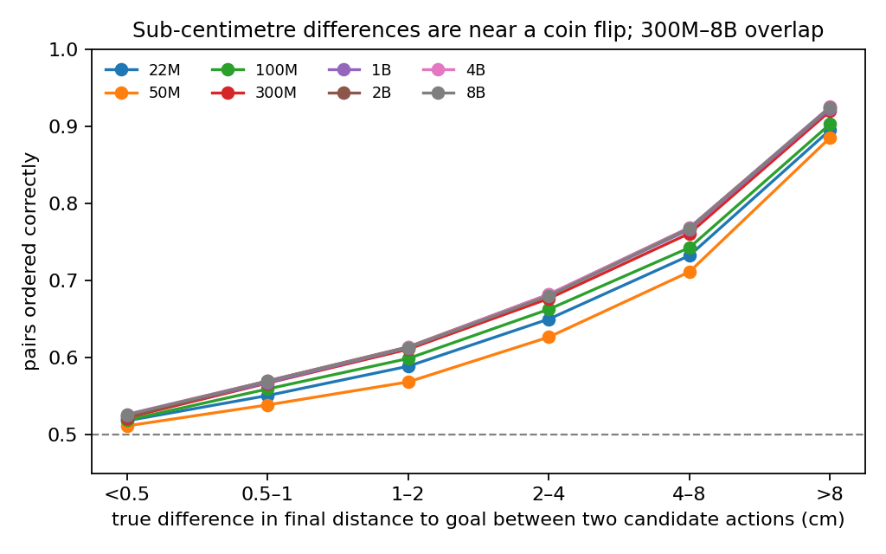

# Better imagination does not mean better choices: where world models break when picking actions

*Draft. Data and evaluator: [Ryukijano/robojepa-rankability](https://huggingface.co/datasets/Ryukijano/robojepa-rankability).
Leaderboard: [Ryukijano/world-model-rankability](https://huggingface.co/spaces/Ryukijano/world-model-rankability).
Code: [Ryukijano/world-model-rankability](https://github.com/Ryukijano/world-model-rankability) on GitHub.
Everything below is measured on simulation or recorded robot video; no physical robot was used.*

A common way to use a world model is to imagine where each candidate action would land and pick the one closest to
your goal. Planners, model-predictive controllers, and action-scoring VLAs all rely on this. The assumption inside it
is simple: if the model imagines the future well, its ranking of candidate actions is good enough to act on.

We built a benchmark to test that assumption directly, then used it to find where it fails. This post walks through
what we measured, in four parts: whether imagination steers choices, where the choices break, whether the break is
simulation-specific, and what it will take to fix it. The short version:

- Ranking of actions stops improving at about 1B parameters while imagination error keeps falling to 8B.
- Two actions whose true outcomes differ by less than 5 mm are ordered at a coin flip by every model size.
- The same millimetre floor appears on real robot video: a 10% change in arm speed is near chance for 22M models.
- Fixing it is not a scoring trick. Looking only at the image regions that move makes ranking worse.
- Our next step is a small model trained from pixels on open real video with hard counterfactual actions.

## 1. Does the imagination steer?

We took 3,499 robot-arm states from RoboCasa kitchens (3,000 from 30 kitchens the models trained on, 499 from 10
held-out kitchens). For each state we fixed 64 candidate arm motions: 32 random and 32 aimed at the goal. The ground
truth is the real outcome of each candidate, measured by replaying it in the MuJoCo simulator from a saved state.
Replays of the same action agree to within 0.2 mm.

Every released RoboJEPA model, 22M to 8B parameters, scored the same fixed candidates with Meta's own planning score:
minus the distance between the imagined next frame and the goal frame, in the V-JEPA 2.1 feature space.

| Model size | Overall Spearman | Fine Spearman (goal-directed only) | Regret | Imagination error |
|---|---:|---:|---:|---:|
| 22M | .747 | .359 | 5.7 cm | .273 |
| 300M | .784 | .411 | 5.1 cm | .240 |
| 1B | .789 | .418 | 5.0 cm | .223 |
| 8B | .789 | .409 | 5.0 cm | .218 |

*3,000 pretraining-kitchen states. Imagination error: distance between the imagined and real next frame. Regret: how
much further from the goal the model's pick ends than the best available candidate.*

The two right-hand columns tell the story. Ranking improves from 22M to about 300M and then stays flat within ±.002
all the way to 8B, while the imagined future keeps getting more accurate. Ordering the candidates that are already
aimed at the goal tops out at a Spearman of about .42, and the single best action is picked only about 5% of the
time, by every model from 300M up.

So there are two different quantities here, and they decouple: how accurate the imagined future is, and whether the
score distinguishes the right action. Past about 1B parameters, more capacity buys better images and not better
choices.

## 2. Where the choices break

We split the candidate pairs by how different their true outcomes are and asked how often the model orders each pair
correctly.

- Under 5 mm of difference: 51 to 53% correct for every model size. A coin flip.
- 1 to 2 cm: 59 to 61%.
- Above 8 cm: 88 to 93%.

The floor does not move with scale. Other things we measured:

- **Failures are shared.** 78% of the states where the 1B pick is more than 5 cm worse than the best candidate are
  also failures for 22M, and 19% fail for all eight sizes. The problem is not capacity; it is something the models
  share, likely the objective or the representation.
- **Height is the weakest direction.** The 1B pick ends 3.0, 2.9 and 3.5 cm off in x, y and height. The best
  candidate available was only 0.6 to 0.7 cm off on each axis, so most of that error is the model's.
- **It is not a scoring artifact.** We tried restricting the score to the image regions that change, the approach
  ThinkWorld uses for its training reward. Ordering got worse at every size, and the harder we restricted the worse
  it got: fine Spearman for the 1B model fell from .418 to .361 (top 50% of patches), .306 (25%) and .260 (10%). The
  action-relevant signal is spread over the frame, and the predictor itself does not resolve fine differences.

This is the part we think is new: a reproducible floor, measured against simulator ground truth, that no released
model size escapes.

## 3. It is not just simulation

To check the floor is not a quirk of the sim benchmark, we ran the same idea on real robot video: 256 held-out DROID
clips from a lab the models never trained on. Given a clip, the models score the true action sequence against 15
alternatives, plus edited versions of the true action.

| Test | Result |
|---|---|
| Pick the true action out of 16 | .996 to 1.0 top-1 for every checkpoint (chance: .0625) |
| True action vs sign-flipped direction | .91 to 1.0 |
| True action vs rotation zeroed | .94 to 1.0 |
| True action vs one-step delay | 1.0 |
| True action vs all-zero | 1.0 |
| **True action vs same action with translation ×0.9** | **22M: .48 to .62; 1B: .79** |
| **True action vs translation ×1.1** | **22M: .50 to .65; 1B: .93** |

Coarse action identity is solved: wrong episode, wrong direction, missing rotation, wrong timing are all detected.
What fails is magnitude. A 10% change in arm speed, about 4 mm per world-model step, is near chance for the 22M
models. Scale helps here: the 1B model resolves it 79% of the time, accumulated over about 15 steps. But that is a
coarser, summed-over-time test than the single-step floor, and it still leaves a quarter of these edits undetected.

## 4. What fixes it

One thing we tried works, with a cost. Fine-tuning RoboJEPA-22M with a ranking loss on replayed outcomes (from 20
states per kitchen in 25 pretraining kitchens) raised held-out overall Spearman to .823 and fine Spearman to .492,
above the frozen 8B, with a control fine-tune at .794/.407. But its imagination error rose from .242 to .268.
Teaching the model to choose made it imagine worse. The two objectives pull against each other.

Our reading of all of this: the floor is in what the predictor represents. The released models run on a frozen
V-JEPA 2.1 encoder, so a fine-tune cannot see what that encoder never encoded. The plan we are now training:

- A small world-action model trained from pixels on open real video (DROID, AgiBot, Open-AoE), LeWM-style.
- Hard counterfactual actions as negatives: the true action scaled ×0.9 or ×1.1, or nudged by millimetres, generated
  from any clip without labels or a simulator.
- The action head's gradients blocked from the shared encoder, so the choose-well and imagine-well objectives do not
  fight over the same features.

The bar is fixed: beat Meta's 1B on the ±10% test (.79 / .93) and its .418 fine Spearman, at a fraction of the size.
You can follow it and poke at the current models on the [benchmark dataset](https://huggingface.co/datasets/Ryukijano/robojepa-rankability),
the [leaderboard](https://huggingface.co/spaces/Ryukijano/world-model-rankability), and the live demo where you can
pick a state, scale the model's own pick, and watch its score change.

## Appendix: protocol

- Task: RoboCasa Reach, PandaOmron robot, agent and wrist cameras, 320×240 frames.
- Candidates: 64 per state, 4-step action chunks, at most 0.18 m reach; 32 random within 0.30 m, 16 coarse and 16 fine goal-directed.
- Model setup: V-JEPA 2.1 ViT-G/384 encoder, embodiment 2, one frame of context, fp16; each model's final released checkpoint.
- Metrics defined in the [dataset card](https://huggingface.co/datasets/Ryukijano/robojepa-rankability): Spearman, AUROC@5cm, regret, Hit@1, pairwise accuracy, ECE, imagination error.
- Reproduce: run `evaluate.py` from the dataset on your own score file; the leaderboard updates from verified submissions.
- Licences: scores derived from RoboJEPA are CC BY-NC-SA 4.0; RoboCasa is MIT. Non-commercial research use.
