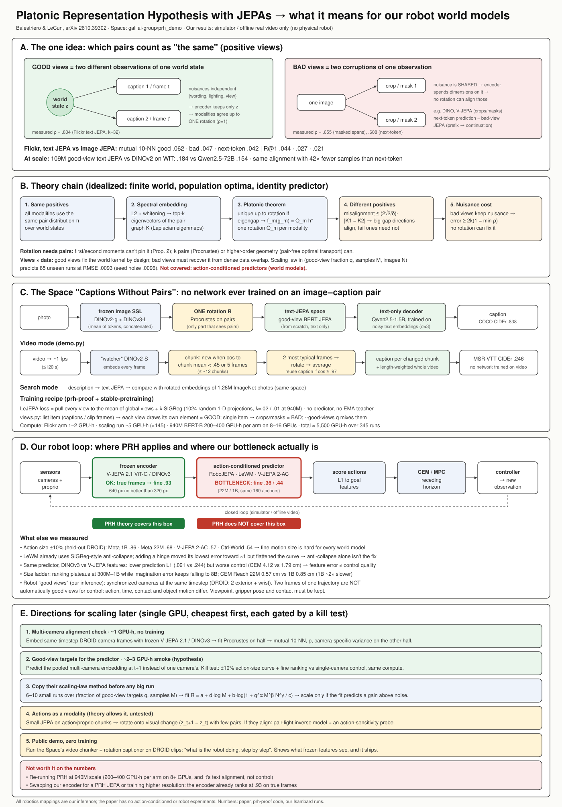

# PRH paper + "Captions Without Pairs" Space: full write-up and what it means for our robot world models

Paper: *Proving and Improving the Platonic Representation Hypothesis with JEPAs*, Balestriero & LeCun, arXiv 2610.39302 (29 Oct 2026).
Space: https://huggingface.co/spaces/galilai-group/prh_demo · Code: github.com/galilai-group/prh-proof (HEAD a2b9949), stable-pretraining @ ab836bf.
Diagram:

Contents:
1. The paper in one page
2. Theory, step by step
3. Experiments and numbers
4. The Space, end to end
5. The training code (code map)
6. Our robot evidence, and where PRH fits
7. Directions for scaling later (and what not to do)
8. Caveats

---

## 1. The paper in one page
- **Claim:** separately trained encoders for different modalities converge to *the same* representation, up to one rotation per modality, if their JEPA positive pairs encode the same relationships between world states. What matters is how positives are chosen, not scale.
- **Good views:** two *different observations* of the same world state, e.g. two captions of one photo or two frames of one clip. The nuisances of the two observations are independent, so the encoder keeps only the world state.
- **Bad views:** two *corruptions of one observation*, e.g. crops of one image or masked spans of one caption. The nuisance is shared, so the encoder spends dimensions on it, and no rotation can align those dimensions across modalities.
- **Next-token prediction is a bad-view JEPA:** the positives are a prefix and its continuation, and the softmax log-partition acts as anti-collapse. It is identifiable only up to a general linear map, not a rotation. This is why LLMs need scale to line up with vision.
- **Headline results:**
  - A 109M good-view text JEPA aligns with DINOv2 better than LLMs up to 72B parameters.
  - It needs 42x fewer samples than next-token prediction for the same alignment.
  - One fitted rotation + a text-only decoder captions images (COCO CIDEr .838).
- **Not covered, stated by the authors:** action-conditioned predictor JEPAs (world models). The predictor is the identity.

---

## 2. Theory, step by step (idealized: finite world z, injective renderings x=g_m(z), population optima)
- **Thm 1 (Platonic Representation Theorem):** if every modality's JEPA uses the same positive-pair distribution pi over world states, and the minimizer is unique up to rotation, all modalities learn the same embedding h*(z) up to one rotation Q_m each.
- **Prop 1:** with an L2 prediction term plus whitening anti-collapse, the JEPA learns the spectral embedding: the top-k eigenvectors of the normalized positive-pair graph K = D^-1/2 Pi D^-1/2 (Laplacian eigenmaps). It is unique up to rotation if there is an eigengap mu_k > mu_k+1.
- **Thm 2:** if the positives differ, misalignment after the best rotation is <= (2*sqrt2/delta) * min(sqrt k * ||K1-K2||_2, ||K1-K2||_F). Directions with large spectral gaps align; tail directions need not.
- **Prop 2:** unpaired first and second moments cannot identify the rotation. k paired points (orthogonal Procrustes) can, and so can higher-order geometry (pair-free OT).
- **Thm 3 / Prop 3:** each observation carries a modality-specific nuisance nu (wording, viewpoint, lighting).
  - Good views: two observations of the same scene with independent nuisances. The encoder learns a function of z only (rho = 1).
  - Bad views: two corruptions of one observation (crops, masks). They share nu, so if a corruption keeps more nuisance than the k-th world direction (beta_1 > alpha_k), dimensions are spent on nuisance, and no rotation can align those.
  - Alignment error >= 2k(1 - min rho).
- **Thm 4:** views plus data induce the world kernel. Bad views get the kernel from data overlap (needs dense data, reach ~ log N/N). Good views fix it by design.
- **Prop 4:** next-token prediction is a bad-view JEPA. The positives are a prefix and its continuation; the anti-collapse term is the log-partition. It is identified only up to GL(k), not a rotation. This explains why LLMs align with vision only through scale.
- Scope note in the paper: the predictor is the identity. **Action-conditioned predictor JEPAs (world models) are explicitly not covered.** The paper also notes that "a world model that acts through a camera must track its viewpoint", so viewpoint is a nuisance only for cross-modal alignment.

---

## 3. Experiments and numbers
- Recipe: LeJEPA (invariance + SIGReg, lambda=.02), stable-pretraining, ViT-S image, BERT-S/B text from scratch. Gradient clipping prevents collapse.
- Flickr30k: good-view text JEPA vs image JEPA, mutual 10-NN .062 vs .047 (bad views) vs .042 (next-token). R@1 .044 vs .027 vs .021. Training next-token on caption pairs barely helps (.043), so the objective matters, not the pairing info.
- Measured rho (k=32): good views .804, bad views .655, next-token .608. The ordering matches Thm 3.
- Ablations: trimming (cropping) each view is the knob that matters. Whole captions lose about 1/4. Other settings move results by <= .016.
- MSR-VTT video: frames of a clip are good image views. Good views on both sides give the best result (.067). DINOv2, whose positives are crops, prefers the crop-trained image JEPA (.144 vs .132), so alignment follows agreement of positives.
- Scale (Recap-DataComp texts):
  - 109M good-view text JEPA on 940M-image texts: WIT 10-NN .184 vs Qwen2.5-72B .154, Llama-3-70B .151, CLIP text .124. CKA .507.
  - 42x fewer samples than next-token prediction for the same alignment.
  - Scaling law in good-view fraction q and samples M predicts 85 unseen runs at RMSE .0093, versus seed noise .0096. It breaks at 4x range for good views (no repeated-data term).
- Captioning with only one rotation fitted on pairs:
  - Text-only decoder with noise sigma = (c^-2 - 1)^1/2 ~ 3, matched to the residual cosine c ~ .3.
  - DINOv2-g + DINOv3-L + Qwen2.5-1.5B decoder: CIDEr .838 on COCO.
  - A rotation transfers across datasets better than an unconstrained linear map or an MLP.
  - Video: mean of rotated frame embeddings gives MSR-VTT CIDEr .246.
- Pair-free (Schnaus et al. protocol, their code unchanged): FOSCTTM .018, CIFAR-10 86.0, CIFAR-100 67.2, ImageNet-100 64.4 top-5. That beats Qwen3-8B (47.6 on ImageNet-100). Next-token prediction fails (.287).

---

## 4. The Space, end to end (Space, gradio, T4)
- DINOv2-g + DINOv3-L features -> one rotation -> text JEPA space -> decoder fine-tuned on text only.
- Modes: caption a photo; caption a video; text search over 1.28M ImageNet photos through the rotated embeddings.
- Video mode: embeds about 1 frame/s with a small "watcher" encoder and cuts a chunk when a frame's cosine to the chunk mean drops below .45 (2-5 s chunks). It re-decodes only when a chunk's mean differs from the last decoded one (cosine < .97). The whole-video caption is the length-weighted mean.
- On CPU it uses beam 3 instead of a consensus of 33 sampled drafts.

How the video mode works, from `demo.py`:
1. `frames(path, fps=1.0)` samples about one frame per second (up to 120 s).
2. A DINOv2-S "watcher" embeds the frames, and they are L2-normalised.
3. `chunks(e, cut=.45, least=2, longest=5, most=12)` starts a new chunk when a frame's cosine to the current chunk mean drops below .45, or the chunk reaches 5 frames. At most about 12 chunks.
4. For each chunk, the `per_chunk=2` frames closest to the chunk mean are rotated into the text-JEPA space and averaged.
5. A chunk whose mean has cosine >= .97 with the previous captioned chunk reuses that caption (`same=.97`).
6. The whole-video caption decodes the chunk embeddings averaged with weights equal to chunk length.

How the rotation works, from `prh/align.py`:
- `procrustes(a, b)`: SVD of a^T b, giving R = U V^T.
- `Rotation.fit` centres both spaces first.
- `refine`: Wasserstein-Procrustes on *unpaired* rows (Sinkhorn plan, then refit).
- `unpaired`: entropic Gromov-Wasserstein, then refine. It stays near chance on near-isotropic embeddings (paper, Prop. 3).
- `project`: snaps a rotated image embedding onto a softmax mixture of real text embeddings (DeCap-style), so the text-only decoder sees inputs it was trained on.

Runtime: one GPU lock serialises inference. Photos are batched 16 (8 on GPUs under 20 GB). On a CPU it uses beam 3 instead of a consensus of 33 drafts.

---

## 5. The training code (code map)
Research snapshot of the checked-out PRH repository and its pinned stable-pretraining dependency. This maps the released training and evaluation path; it is not an implementation plan or a claim that the recipe already supports robot control.

### Repositories and entry points

- PRH source: `prh-proof` (HEAD `a2b9949fa907d4fbe562742d4b1ffa7205ab7427`).
- Training framework: `stable-pretraining` at `ab836bf699a2be712dfcf980a5eb70d36391e876`.
- Reproduction guide says the paper numbers come from `train.py` → `evaluate.py` → `tables.py` → `figures.py`; `paper/runs.csv` registers the run arguments and states. See `prh-proof/docs/reproduce.md:3-19` and `prh-proof/README.md:97-119`.

The principal command is `python train.py --modality {image,text}`. Its `--objective` selects LeJEPA (default), next-token prediction (`ntp`), or caption decoding (`decode`); network construction dispatches those paths in `train.py:36-100,146-159`. The forward functions are in `prh/forward.py:17-60`.

| Experiment | Entry point and recorded recipe |
|---|---|
| Image JEPA | `train.py --modality image` builds a LeJEPA ViT from scratch. The default recipe is 200 epochs, batch 256/GPU, LR `5e-4`, lambda `0.02`; the quick-start guide estimates about 2 GPU-hours. `train.py:36-86,146-159`; `docs/reproduce.md:78-90`; `README.md:81-90`. |
| Text JEPA, good/bad views | `train.py --modality text` uses the LeJEPA objective with a text backbone. `--good-views Q` (alias `--caption-views`) means a fraction `Q` of samples draw different captions per view; `Q=0` is the bad-view arm and `Q=1` the good-view arm. Flickr/COCO and Recap recipes are in `docs/reproduce.md:78-90,136-159,199-204`. |
| Text next-token control | `train.py --modality text --objective ntp`; the paired-caption control also sets `--caption-views`. It uses a causal text encoder and tied vocabulary projection. `train.py:36-55,146-150`; `prh/forward.py:31-43`; `docs/reproduce.md:78-90,138-153`. |
| MSR-VTT/video | `MSRVTTClips` makes eight-frame clips available to image-view training and evaluates the middle frame. Reproduction recipes specify 800 epochs and validation every 40 epochs for the MSR-VTT arms. Video captioning/alignment runs the existing captioner over the mean of eight frame embeddings; the docs explicitly say no network was trained on video. `prh/data.py:48-49,289-336`; `docs/reproduce.md:118-133,257-267`; `evaluate.py:337-385,448-477`. |
| Recap-DataComp scale | Text recipes use `recaptext:<file-count>`; examples range from 10M to all 940M images. The all-file BERT-B run uses `--epoch-size 10000000 --epochs 90 --batch-size 256 --devices 8 --shard-data --lamb 0.01`; bad-view and NTP controls remove the good-view flag or select `ntp`. `docs/reproduce.md:136-159`. |
| Decoder/captioner | Text-only decoder training uses `train.py --modality text --objective decode --encoder <frozen text-JEPA checkpoint>`. The guide includes a 40-epoch Flickr noise sweep and Qwen2.5-1.5B decoder runs on Flickr/COCO or Recap text. The captioner bundles the decoder, fitted rotation, image-model name and optional text JEPA. `docs/reproduce.md:216-255`; `train.py:70-74,150-155`; `prh/captioner.py:71-99`. |
| Rotation fitting | `caption.py` fits a cross-space map from paired image/text embeddings; `Rotation.fit` uses centered orthogonal Procrustes, `fit_pooled` pools pair sets, and `refine` performs Wasserstein-Procrustes steps. The standard captioner uses DINO image features and a text-JEPA space; the rotation is the part fitted on pairs. `prh/align.py:64-91`; `README.md:121-126`; `docs/reproduce.md:229-255`. |
| Pair-free alignment | `evaluate.py pairfree` wraps pinned `unpaired_rosetta` Wasserstein-Procrustes; the default fit uses zero known pairs, with paired Procrustes and shuffled controls separately available. The code delegates fit and retrieval metric implementations to the dependency. `docs/reproduce.md:269-289`; `prh/pairfree.py:106-131,141-156`. |

### LeJEPA objective, model and views

**Loss.** The stable-pretraining LeJEPA code takes the mean of the global-view projected embeddings as a center, penalizes squared deviation of every projected view from that center, and adds SIGReg on all flattened view projections. In notation matching the implementation, `loss = inv_loss + lamb * sigreg_loss`. This is the exact computation in `stable-pretraining/stable_pretraining/methods/lejepa.py:253-274`; its architecture and defaults are documented at `:150-169`.

SIGReg projects onto 1,024 random normalized one-dimensional directions by default, then averages the Epps–Pulley statistics over those directions. The statistic compares empirical cosine/sine characteristic functions against the standard normal characteristic function. Defaults are `t_max=3.0`, 17 quadrature points and `lambda=0.02`; see `stable-pretraining/stable_pretraining/methods/lejepa.py:42-90,89-131,209-250`. The standard 940M run recipe uses `lambda=0.01`; the earlier 940M seed-0 configuration uses `0.02`. Reproduction docs explain the per-GPU-batch effect at this pinned revision: `prh-proof/docs/reproduce.md:23,151-159`.

There is **no separate learned predictor module** in the LeJEPA objective. It trains a projection head and enforces view invariance plus distribution regularization; calling the predictor “identity” is not a literal description of a predictor object in this code. The next-token arm does have an explicit causal prediction loss and is a distinct control. `stable-pretraining/stable_pretraining/methods/lejepa.py:150-169,253-274`; `prh/forward.py:31-43`.

**Dimensions.** Let `D` be the backbone embedding width. The default projector is a `Linear(D,512)` followed by an MLP with hidden channels `[2048,2048,512]`, so its output width `K` is 512. Evaluation writes both the raw backbone `embedding` (`D`) and `proj` (`K`); the paper’s primary embedding is the backbone output. `stable-pretraining/stable_pretraining/methods/lejepa.py:163-169,230-252`; `prh/forward.py:13-28`. Text presets are Tiny `(192 width, 3 heads, 12 layers)`, Small `(384, 6, 12)`, Base `(768, 12, 12)` and Large `(1024, 16, 24)`. The text BERT is randomly initialized (`pretrained=False`) and uses the `bert-base-uncased` tokenizer. `prh/models.py:16-18,42-68`.

**View construction.**

- The command defaults to two global and six local views. Image views are independent random resized crops: global 224-pixel crops at scale `0.3–1.0`, local 96-pixel crops at `0.05–0.3`; image photometric transforms are applied on GPU. `train.py:63-68`; `prh/views.py:132-178`.
- Text views use the same underlying item. With good views, the dataset supplies the captions and each view selects one; a scalar caption gives bad views, which use independently sampled text spans and token masking. Global text spans retain `0.5–1.0` of the text, local spans `0.15–0.5`; the default masked fraction is 0.15. `prh/data.py:65-74`; `prh/views.py:16-59,132-178`.
- For MSR-VTT, good views choose independently among the clip’s frames; bad views start from one random frame. Evaluation uses the middle frame. `prh/data.py:298-336`; `prh/views.py:112-116`.
- The NTP pair control forms `[CLS] a [SEP] b [SEP]` from two captions when available; ordinary NTP uses one caption. Decoder views retain captions as written. `prh/views.py:16-59,148-162`.

### Training scale, schedule and compute

At the pinned revision, the default training configuration is 200 epochs, batch size 256 per GPU, AdamW LR `5e-4`, weight decay `0.05`, betas `(0.9,0.999)`, lambda `0.02`, no clipping, 16 dataloader workers and bf16 mixed precision when CUDA is available (otherwise fp32). The scheduler is step-wise linear warmup/cosine annealing, starts at 1% of peak LR, ends at `LR/1000`, and uses the calculated total step count. The default total is `len(train_loader)//(devices*nodes) * epochs`; `--steps` can cap it. `train.py:75-87,171-210`.

Longer text runs commonly use LR `1e-4`, clip norm `1.0`, and 64-token inputs. The 940M BERT-B example trains 90 epochs at a 10M sample epoch size (the guide describes 900M samples), batch 256/GPU on eight GPUs, with `--shard-data` and lambda `0.01`. A seed-0 940M run uses two nodes × eight GPUs, batch 128/GPU and lambda `0.02`. These run arguments and the SIGReg scaling note are in `docs/reproduce.md:138-159`. **Derived arithmetic:** both listed 8-GPU layouts have a nominal global batch of 2,048.

The repository reports 345 runs and about 5,500 GPU-hours including preemptions: 1–2 hours per Flickr JEPA arm; about 5 hours on average for 145 Recap scaling runs; 14 hours for BERT-S on 100M-image text at 80M samples; 200–400 hours per 940M-image BERT-B seed and arm (8–16 GPUs); and about 200 hours for ViT-S ImageNet-1k (300 epochs, 8 GPUs). The quick-start estimates one GPU-hour for good-view text and two for image JEPA. `README.md:81-90,97-119`.

The cited source specifies GPU counts and PyTorch/CUDA precision behavior but does not identify a GPU SKU in these run recipes. The exact architecture dimensions are above; the README labels the large text-JEPA result as 109M parameters. `README.md:38-40`; `prh/models.py:16-18`.

### Recap-DataComp data pipeline and repeats

The 940M text corpus is the sorted set of 4,627 Parquet files under `data/train_data`; the README describes roughly 203k images per file and up to 492 GB of text data. Each row can provide `org_caption`, `re_caption`, and `re_caption_condition_diverse_topk` (alt text and two LLaVA recaptions). `README.md:71-79`; `prh/data.py:48-57,142-173`.

This is a map-style PyTorch dataset, not a remote row-streaming reader: `RecapText` selects the first `n_files`, reads selected columns with `pyarrow.parquet.read_table`, concatenates Arrow tables, then tokenizes the selected row lazily in `__getitem__`. The PyTorch `DataLoader` uses the configured batch size, pin-memory and persistent workers. `prh/data.py:142-173`; `train.py:115-125,133-143`. With `--shard-data`, the rank/world pair comes from the launcher environment and each rank selects every `world`-th file starting at its rank. The code comments that this is about 0.3 GB per file per rank. `train.py:103-106,133-135`; `prh/data.py:142-164`.

The separate image path indexes JPEG/JSON byte offsets in tar shards, caches the index, and reads image bytes in place; it is not the 940M text loader. `prh/data.py:225-273`.

No general training-time deduplication pass is evidenced in these paths. `EpochSampler` wraps `RandomSampler(num_samples=...)`, documented as sampling without replacement within the epoch. The sampler does not persist a global seen set between epochs, so cross-epoch repeats are permitted (**inference from the sampler lifecycle**). `prh/data.py:77-91`; `train.py:115-122`. A distinct overlap analysis checks WIT captions and Flickr/COCO image overlap against Recap; it reports matches but does not remove training rows. `prh/data.py:515-550`; `docs/reproduce.md:177-180`.

### Scaling-law fit

The target is Flickr test `R@1` through the 30k-pair rotation (`r1` in `phase_grid.csv`). The fitted form is

`R@1 = a + d log(M) + b log(1 + q^alpha * M^beta * N^gamma / c)`

where `q` is the good-view fraction, `M` is samples seen in millions, and `N` is unique images in millions. `tables.py:51-56,77-96`.

The phase grid uses image counts 0.41M, 2.24M, 10.2M and 50.9M with `q ∈ {0, .001, .003, .01, .03, .1, .3, 1}` at 20M samples; on 10.2M images it also uses `q ∈ {0,.01,.1,.3,1}` at 5M, 40M and 80M, plus 25 registered random `q,M` points. The 320M-sample condition uses `q ∈ {0,.1,1}`. `docs/reproduce.md:199-204`; `tables.py:31-33,59-74`. In code, the 320M cells are tagged `long`; the v2 fit selects the grid cells through 80M, while v1 selects grid cells at or below 20M. `tables.py:67-78`.

`curve_fit` fits the seven parameters, with bounded parameter ranges. The checked-in fit values (rounded here; the CSV carries full precision and standard errors) are:

| fit | `a` | `d` | `b` | `c` | `alpha` | `beta` | `gamma` | fit RMSE |
|---|---:|---:|---:|---:|---:|---:|---:|---:|
| v1 | 0.18735 | 0.02304 | 0.02010 | 0.24882 | 1.38004 | 0.78776 | 0.25963 | 0.00680 |
| v2 | 0.17079 | 0.02894 | 0.03066 | 0.24397 | 1.06845 | 0.31681 | 0.19305 | 0.00718 |

`paper/data/phase_law_fit.csv:1-17`; fit selection and RMSE calculation: `tables.py:77-96,241-261`.

### Evaluation metrics

- **Mutual k-NN:** forms cosine k-nearest-neighbor masks for paired rows and reports the mean fraction of shared neighbors (default `k=10`). `prh/metrics.py:12-23`.
- **CKA:** linear CKA from Gram matrices using an unbiased HSIC estimator. `prh/metrics.py:26-38`.
- **rho/Spearman:** `sts_spearman` centers the paired embeddings by their shared mean, computes paired cosine similarities and correlates them with human STS scores using Spearman’s rho. `prh/metrics.py:214-222`.
- **FOSCTTM:** the PRH wrapper delegates to `unpaired_rosetta.evaluation.retrieval_metrics`; the implementation is external to this repository. The wrapper also computes R@1/R@5 for datasets of at most 10,000 rows. `prh/pairfree.py:141-156`. The repository’s pair-free fit itself delegates to the pinned dependency’s Wasserstein-Procrustes implementation. `prh/pairfree.py:116-131`.

### Video, actions and world models

The video code is an evaluation/captioning path: it extracts eight frames per MSR-VTT clip, embeds them with the photo captioner and averages frame representations. The reproduction guide explicitly states “no network trained on video.” `prh/data.py:48-49,298-336`; `evaluate.py:337-385`; `docs/reproduce.md:257-267`.

I found no action-conditioned predictor or robot world-model training recipe in the inspected PRH training, data, evaluation and reproduction paths. The LeJEPA method accepts image/text views and has no action input; the MSR-VTT path is frame-based evaluation rather than video dynamics learning. `train.py:36-68,146-159`; `prh/forward.py:17-28`; `docs/reproduce.md:257-267`. No action/world-model TODO was identified in these paths.

### Stable-pretraining reuse and aarch64

Stable-pretraining provides the LeJEPA loss/backbone, `Module`/`Manager` training lifecycle, data integration and callbacks. Its separate I-JEPA implementation includes a transformer predictor for masked image-patch targets: the constructor wraps an image encoder with an EMA teacher and creates a predictor over patch positions; its training path predicts teacher patch targets. `stable-pretraining/stable_pretraining/methods/ijepa.py:142-187,226-320`; `stable-pretraining/stable_pretraining/module.py:96-115`; `stable-pretraining/stable_pretraining/manager.py:512,1904`.

**Inference — transfer:** these are reusable building blocks, not a drop-in video-plus-action world model. The inspected I-JEPA predictor is configured around image patch embeddings/positions and has no action argument. A robot version would need an action-conditioned input/embedding, temporal data and target construction, and a rollout or prediction objective; the framework can host custom forward/model components, but the repository does not supply this robotics path.

The pinned `pyproject.toml` declares PyTorch, torchvision, PyArrow, Minari/HDF5, scikit-learn, OpenCV and other dependencies (`stable-pretraining/pyproject.toml:11-64`). I found no explicit `aarch64`/`arm64` support declaration or runtime test in the repository. **Inference:** some dependencies use compiled native components, so aarch64 viability depends on compatible wheels/build support for the selected versions; the source alone does not establish that it runs on aarch64.

### Hugging Face Space and model repositories

The local Space source is `prh_demo`. `app.py` reads `PRH_WEIGHTS`, uses the value as a local directory when applicable or passes it to `snapshot_download`, then loads `captioner.pt` and gallery assets. `prh_demo/app.py:16-22`; the README links the Space to the project/repository but does not state the environment value (`prh_demo/README.md:16-22`). A search of Space source/README and the PRH repository did **not** identify the `PRH_WEIGHTS` model-repository ID. Therefore its file list cannot be reported, and no large files were downloaded.

The following public model IDs are code/recipe references, **not proof of the deployed `PRH_WEIGHTS` value or of the exact contents of its bundle**:

| Role | Repository/model reference | Evidence and qualification |
|---|---|---|
| Image encoder | [`timm/vit_giant_patch14_dinov2.lvd142m`](https://huggingface.co/timm/vit_giant_patch14_dinov2.lvd142m) | Alias `dinov2-g` maps to this timm architecture; the strongest captioner recipe uses `dinov2-g+avg`. `prh/features.py:32-39`; `docs/reproduce.md:289-298`. |
| Image encoder | [`timm/vit_large_patch16_dinov3.lvd1689m`](https://huggingface.co/timm/vit_large_patch16_dinov3.lvd1689m) | Alias `dinov3-l`; used alongside DINOv2-G in the strongest captioner recipe. `prh/features.py:32-39`; `docs/reproduce.md:289-298`. Hub API metadata identifies the corresponding `timm/...` repositories. |
| Text tokenizer | [`bert-base-uncased`](https://huggingface.co/bert-base-uncased) | Tokenizer reference for the optional text JEPA; the PRH BERT weights are randomly initialized and the captioner bundle stores its optional text-JEPA weights. `prh/models.py:16-18,42-68`; `prh/captioner.py:80-99`. |
| Decoder configuration | [`Qwen/Qwen2.5-1.5B`](https://huggingface.co/Qwen/Qwen2.5-1.5B) | Used by the documented Qwen captioner recipe. The deployed bundle’s exact decoder config is not exposed by the Space source. `docs/reproduce.md:269-272`; `prh/models.py:208-233`. |

The Space’s bundle serializes the image-model string, decoder configuration/weights, rotation and optional text-JEPA state; without the runtime `PRH_WEIGHTS` value or that bundle, the specific image-model combination and decoder selected by the deployed app cannot be confirmed. `prh/captioner.py:80-99`.

### Evidence limits

Both requested repositories cloned successfully; no clone error occurred. This map uses local source, reproduction docs, run registry and checked-in fit tables. Hardware model/SKU and deployed Space environment values are not specified in those sources. Statements marked **Inference** are interpretations of the code paths, not claimed repository facts.

---

## 6. Our robot evidence, and where PRH fits
All results below are from simulation or offline real video. Nothing has been validated on a physical robot.

**The loop:** camera/proprio → frozen encoder (V-JEPA 2.1 ViT-G, DINOv3, ...) → action-conditioned predictor (RoboJEPA 22M-8B, LeWM, V-JEPA 2-AC, Ctrl-World) → score candidate actions (L1 to goal features) → CEM/MPC → low-level controller.

| Evidence | Number | Reading |
|---|---|---|
| True post-action frames, frozen V-JEPA 2.1 + L1 (160 anchors, 320x240) | fine Spearman .933, regret 0.10 cm | the encoder + cost can rank fine outcomes |
| Same anchors with predicted frames: 1B / 22M | .442 / .360 | **the predictor is the bottleneck** |
| 640x480 vs 320x240 true frames | −.012 fine Spearman [−.015, −.009] | resolution is not the bottleneck |
| Fixed predictor, V-JEPA vs DINOv3 features | fine .298 vs .215; CEM median 1.79 vs 4.12 cm | lower feature L1 (DINOv3 .091) does not mean better control |
| RoboJEPA size ladder | ranking plateaus at 300M-1B; imagination error keeps falling to 8B | scale improves prediction more than decision quality |
| Action-scale ±10% (held-out DROID): Meta 1B / 22M / V-JEPA 2-AC / Ctrl-World | .86 / .68 / .57 / .54 | fine motion size is hard for every world model we tested |
| LeWM (SIGReg-style) + hinge | lowest error moved to ~x0.9-0.97 but the curve flattened | anti-collapse + margin did not create a centred minimum |
| 22M plain DROID fine-tune, 1k steps | ±10% .682 → .703 (margin loss: .627) | small gain; one 256-clip eval, no confidence interval |
| CEM Reach, 22M vs 1B (20 episodes each) | 0.57 vs 0.85 cm median; 1B is ~2x slower | no closed-loop advantage from 1B on Reach |

**Where PRH fits:**
- PRH explains *representations*. Our representation already ranks well on true frames (.93). The part that fails is predicting the consequences of an action, and PRH does not cover predictors.
- V-JEPA and DINO are trained on crop/mask positives, i.e. bad views. PRH predicts they carry camera and viewpoint nuisance. For control, some of that "nuisance" is signal: the paper notes that a world model acting through a camera must track its viewpoint. Gripper pose, contact and velocity must survive too.
- Two frames from the same trajectory are **not** automatically good views for control. Action, time, contact and object motion differ between them. The clean robotics analogue of good views is **synchronized cameras at the same timestep** (DROID has 2 exterior + 1 wrist), or the same physical state reached twice.
- LeWM already uses SIGReg-style anti-collapse and still failed. So the missing piece is not anti-collapse; it is likely what the predictor's targets and positives ask it to distinguish. That is a hypothesis, not a result.

---

## 7. Directions for scaling later, cheapest first (all single GPU)
1. **Multi-camera alignment diagnostic.** About 1 GPU-h, no training. Embed same-timestep DROID exterior-1, exterior-2 and wrist frames with frozen V-JEPA 2.1 and DINOv3. Then:
   - fit Procrustes on half the timesteps;
   - measure mutual 10-NN and rho on the other half, plus how much variance is camera-specific.
   - This tells us how much of each embedding is scene versus camera.
2. **Good-view targets for the predictor.** Hypothesis, needs a smoke run of about 2-3 GPU-h. Train the action-conditioned predictor so the latent at t+1 predicts the *pooled multi-camera* embedding at t+1, not one camera's embedding. Positives are then "same world state, different camera", which are PRH good views. Kill test: the ±10% action-scale curve and fine ranking against the single-camera control at the same compute.
3. **Copy the scaling-law method before any big run.** Run a grid of 6-10 small runs over q (fraction of multi-camera targets) and M (samples), then fit the PRH form. Scale only if the fit predicts a gain over the noise floor. This replaces "train big and hope".
4. **Actions as a modality.** Theory only, untested in the paper. Embed short action/proprio chunks with a small JEPA. Fit a rotation to video-embedding deltas (z_t+1 - z_t) on few pairs. If they align, actions and visual change share geometry, which would give a pair-light inverse model and an action-sensitivity check.
5. **Demo reuse, zero training.** The Space's chunker plus rotation captioner works on robot video as-is. A "describe what the robot is doing, step by step" Space for DROID clips is a cheap public demo and a probe of what frozen features see.

### Not worth it (on the numbers)
- Re-running PRH at 940M scale: 200-400 GPU-h per arm on 8+ GPUs. Out of scope for single GPU, and it is about text, not control.
- Swapping our encoder for a PRH text/image JEPA: our encoder is not the bottleneck.

---

## 8. Caveats
- The theorems are idealized: a finite world, injective renderings, population optima. Uniqueness is proven for second-order (whitening) anti-collapse, not for SIGReg.
- No experiment satisfies Thm 1 exactly. The image side mostly uses bad views (crops).
- The Recap-DataComp texts were written by LLaVA, which has a CLIP vision tower, so image-text pairing information is partly baked in. On raw alt-text, good views reach .060 vs .107.
- The deployed Space's `PRH_WEIGHTS` repository id is not in the source, so the exact bundle (encoders, decoder) is inferred from the README and the reproduce guide.
- Every robotics mapping in sections 6-7 is our inference. The paper has no action-conditioned or robot experiments.
